# Maldives theme for Claude

A living Maldives lagoon behind your conversations in the Claude desktop app. Whatever Claude is doing, you can see it on the water.

https://github.com/user-attachments/assets/db042e09-37c8-41fc-bdda-ec96829b9b3e

| Day | Night |
| --- | --- |
| 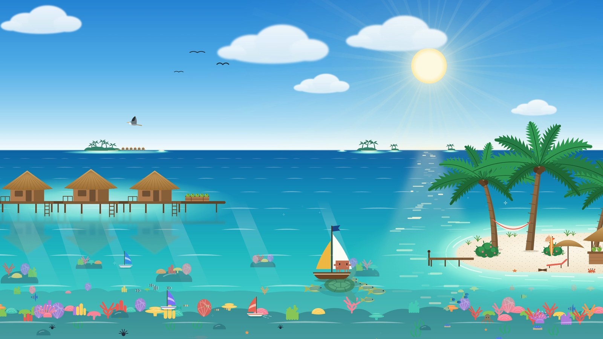 | 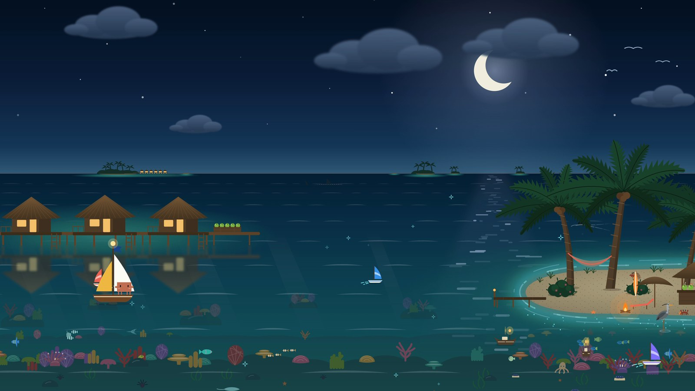 |

It follows the app's light or dark appearance.

## What Claude does, on the water

| | | |
| :---: | :---: | :---: |
| 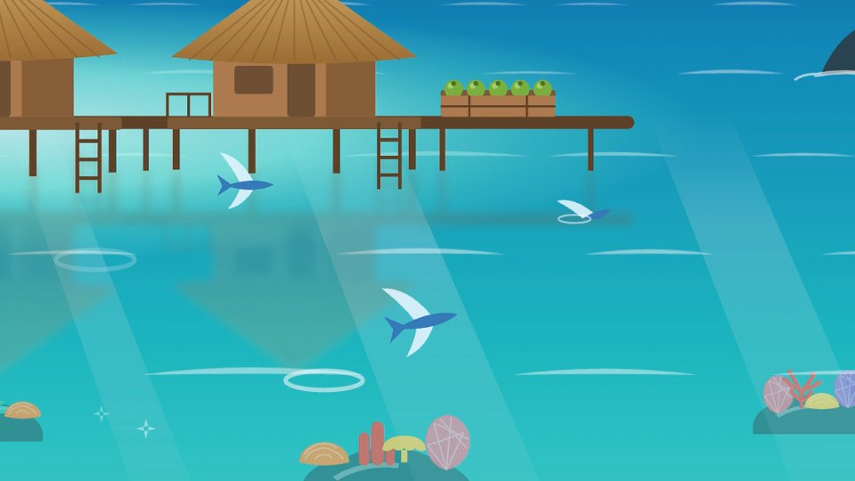 | 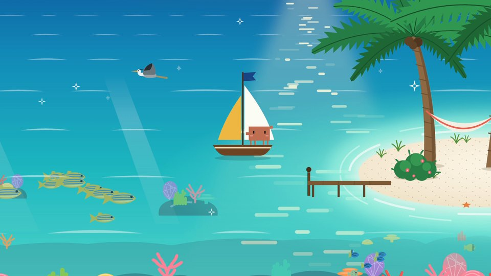 | 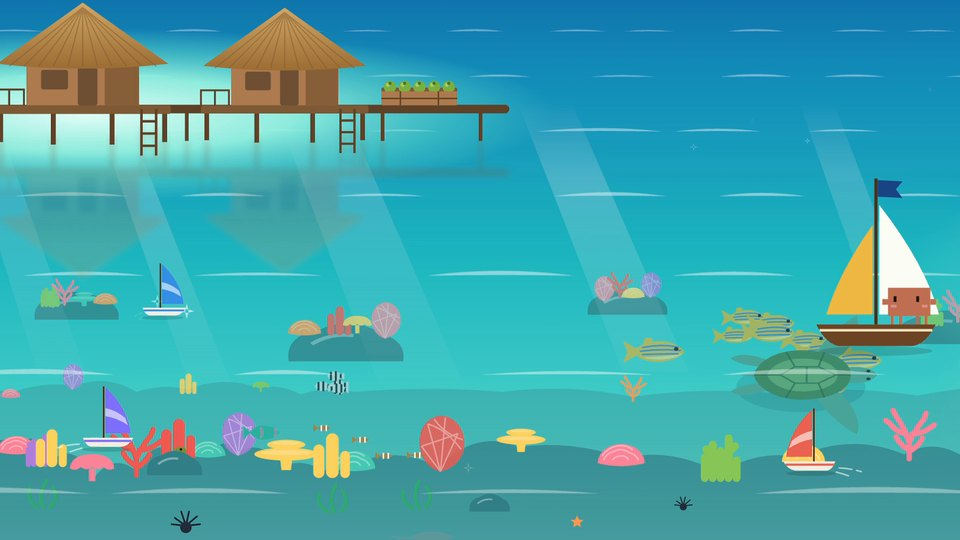 |
| **You send a prompt**<br>The flying fish leap | **Claude works**<br>Clawd sails out | **Subagents**<br>A dinghy each |
| 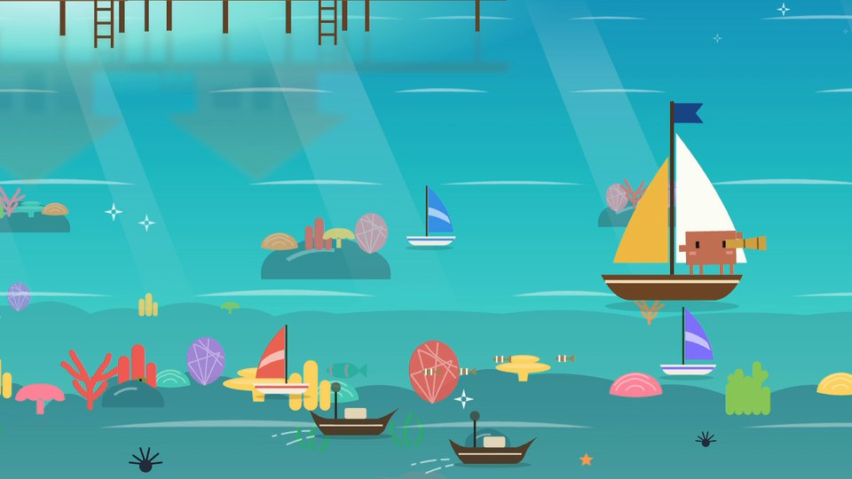 | 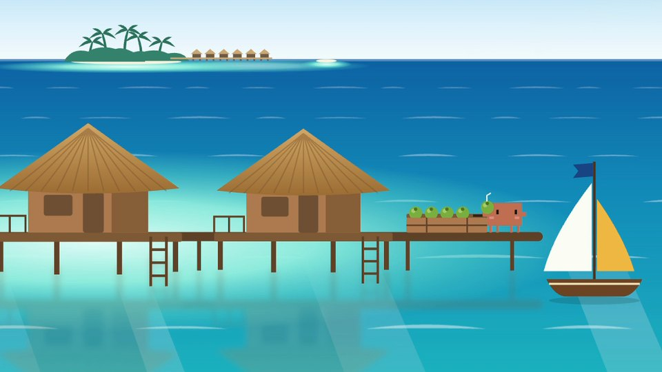 | 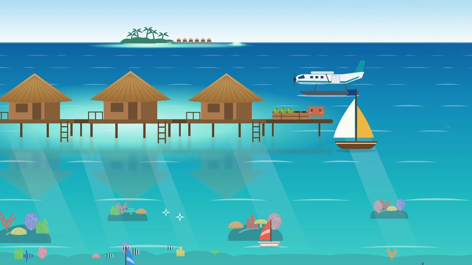 |
| **Background shells**<br>A fishing boat each | **Context used**<br>A coconut gone per fifth | **Compaction**<br>A seaplane brings a full crate |
| 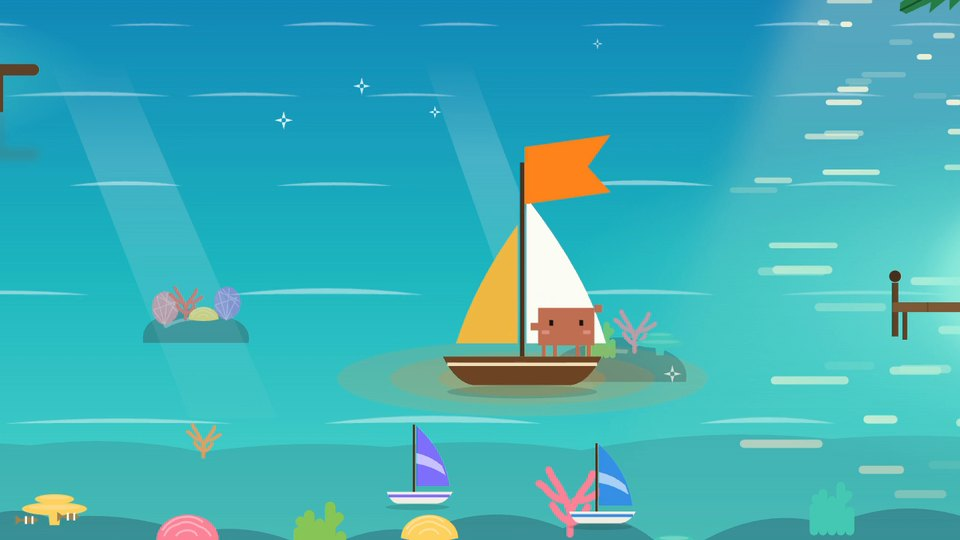 | 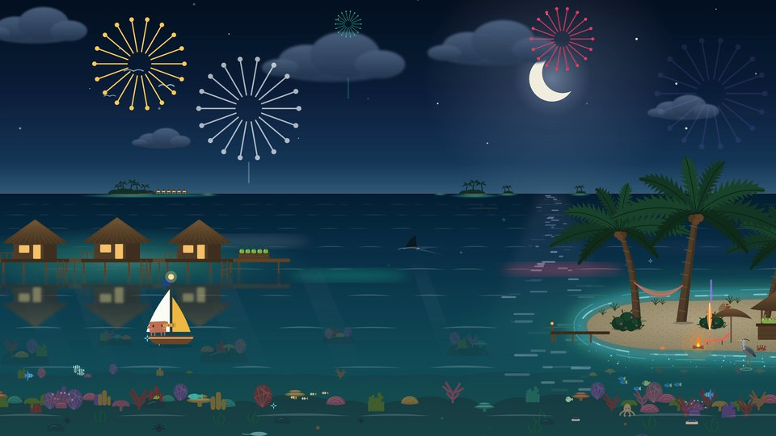 | 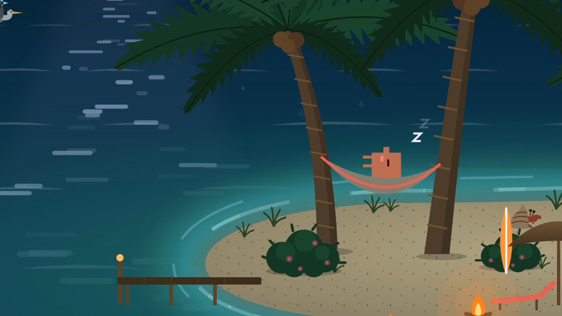 |
| **Claude waits for you**<br>The boat flies a flag | **A push or a PR**<br>Fireworks | **The turn is over**<br>Home to the island |

## Install

In the desktop app: **+** next to the prompt box, **Plugins**, **Add marketplace** with `davidYichengWei/claude-maldives-theme`, then **Add plugin**.

Or from a shell:

```bash
claude plugin install maldives --marketplace davidYichengWei/claude-maldives-theme
```

The backdrop is drawn by the desktop and mobile apps; in a terminal the theme sets its colours only.

## Try it

The **Control Panel** above the prompt previews every state without waiting for Claude to do the work: boats, coconuts, the seaplane, fireworks, Clawd's pastimes, wildlife, light and dark. **Hide chat** shows the lagoon whole.

`/maldives demo` plays a whole day on its own, about seven and a half minutes, for a screen recording.

<details>
<summary>All <code>/maldives</code> commands</summary>

A preview only changes what the backdrop shows; Claude's next real event takes over again.

| Command | What it does |
| --- | --- |
| `idle`, `working`, `done`, `error` | Show that state |
| `permission`, `question`, `plan` | Show Claude waiting on you for that |
| `crew [0-5]`, `shells [0-5]` | Put that many dinghies or fishing boats on the water |
| `drink`, `resupply` | Use up a fifth of the context; bring a full crate by seaplane |
| `fireworks` | Fireworks over the lagoon |
| `island fish`, `nap`, `sun`, `sip`, `fire`, `tour` | Send Clawd to that pastime on the island, or round them all |
| `visit snappers`, `bannerfish`, `turtle`, `manta`, `ray`, `whaleShark`, `fin`, `dolphins`, `gulls` | Call up one more of that kind |
| `light`, `dark`, `auto` | Force a light or dark scene, or follow the app again |
| `reset` | Drop the previews and show what Claude is really doing |
| `panel` | Show or hide the Control Panel |
| `demo`, `demo stop` | Play a whole day on its own; stop it early |
| `debug` | Print what the backdrop is showing and when it was last drawn |

</details>

<details>
<summary>Developing</summary>

The plugin is a Claude Code hooks module: `hooks/register.tsx` wires it to Claude's events, `hooks/scene.ts` draws the SVG scene, `hooks/voyage.ts` plans the boat trips and Clawd's day, and `hooks/fleet.ts` the other boats. `hooks/make-colors.js` is generated by Claude Code's theme tooling and is kept as it is.

To run your working copy, add the folder as a marketplace and install from it; after an edit, `/reload-plugins` picks the change up:

```bash
claude plugin marketplace add /path/to/claude-maldives-theme
```

```bash
claude plugin install maldives@claude-maldives-theme
```

`claude plugin validate .` checks the manifest and the module, and `claude plugin test .` runs the tests in `test/`. The scripts in `dev/` check the scene without the app (`npm install` there first):

| Script | What it checks |
| --- | --- |
| `npm run fuzz` | Hundreds of random trips build valid CSS, every animation on the scene's 60-a-second clock |
| `npm run size` | The scene stays under the size the app accepts |
| `node verify/grid.cjs <scene.svg>` | Lists any animation that changes off the clock, and what it costs |
| `node verify/perf.cjs <scene.svg>` | The CPU Chromium spends keeping a scene playing |
| `npm run states` | Every state renders; boat routes keep clear of the island and the jetty |
| `npm run frames` | Renders still frames of a trip and of Clawd's day to PNG |
| `npm run fleet`, `npm run sides` | Boats come and go, and alternate the edge they use |

</details>

## 中文说明

给 Claude 桌面 App 用的马尔代夫主题：对话背后是一片会动的泻湖，Claude 在做什么，海面上都看得见。派活时飞鱼跃起，工作时 Clawd 乘帆船出海，每个 subagent 是一艘小艇，每个后台任务是一艘渔船；context 每用掉五分之一就少一个椰子，压缩时水上飞机送来一整箱；等你批准时船上挂旗，push 时放烟花，任务结束后 Clawd 回岛休息。

## License

MIT
</content>
</invoke>
