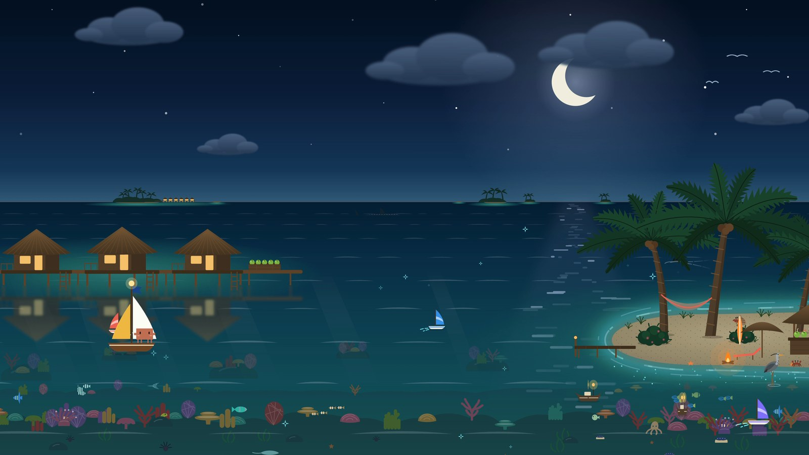
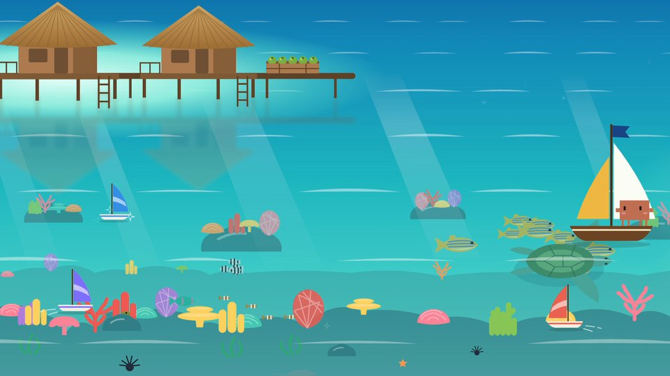
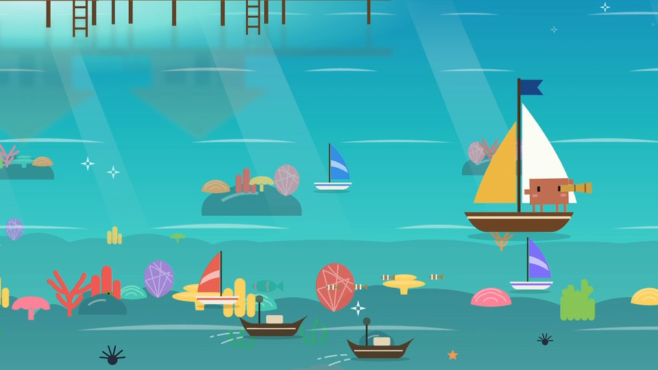
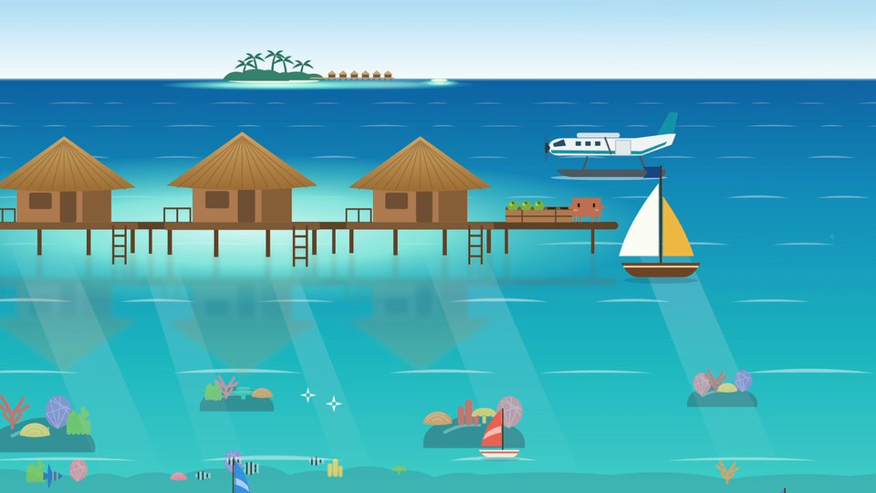
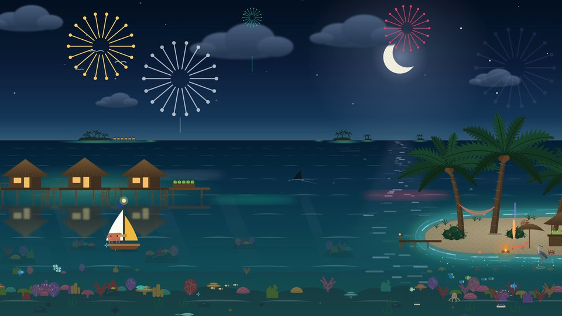
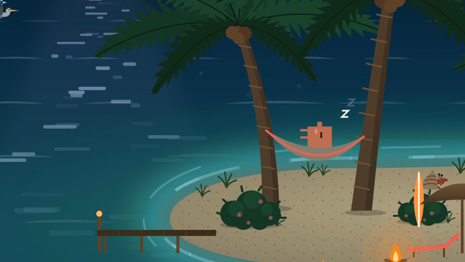

# Claude 的马尔代夫主题

[English](README.md) | 中文

给 Claude 桌面 App 用的主题：对话背后是一片会动的马尔代夫泻湖。Claude 在做什么，海面上都看得见。

https://github.com/user-attachments/assets/db042e09-37c8-41fc-bdda-ec96829b9b3e

| 白天 | 夜晚 |
| --- | --- |
|  |  |

白天和夜晚跟随 App 的浅色、深色模式切换。

## Claude 做的事，都在海面上

| | | |
| :---: | :---: | :---: |
|  |  |  |
| **给 Claude 派活**<br>飞鱼跃起 | **Claude 工作**<br>Clawd 出海 | **Subagent**<br>每个一艘小艇 |
|  |  |  |
| **后台任务**<br>每个一艘渔船 | **消耗 Context**<br>每用掉五分之一少一个椰子 | **压缩 Context**<br>水上飞机送来满箱椰子 |
|  |  |  |
| **等待你的批准**<br>船上挂旗 | **Push 或开 PR**<br>放烟花 | **任务完成**<br>回岛休息 |

## 安装

在桌面 App 里：点输入框旁的 **+**，选 **Plugins**，**Add marketplace** 填入 `davidYichengWei/claude-maldives-theme`，再点 **Add plugin**。

或者在终端里：

```bash
claude plugin install maldives --marketplace davidYichengWei/claude-maldives-theme
```

动画背景由桌面和手机 App 绘制；在终端里只会套用主题配色。

## 试一试

输入框上方的**控制面板**可以直接预览每一种状态，不用等 Claude 真的去干活：船只、椰子、水上飞机、烟花、Clawd 在岛上的消遣、野生动物，以及白天和夜晚。点 **Hide chat** 可以隐藏对话，看到完整的海景。

`/maldives demo` 会自动演完完整的一天，约七分半钟，适合录屏。

<details>
<summary>全部 <code>/maldives</code> 命令</summary>

预览只改变背景显示的内容；Claude 下一次真实的动作会把它覆盖掉。

| 命令 | 作用 |
| --- | --- |
| `idle`、`working`、`done`、`error` | 显示对应的状态 |
| `permission`、`question`、`plan` | 显示 Claude 在等你批准工具、回答问题或批准计划 |
| `crew [0-5]`、`shells [0-5]` | 在海上放出相应数量的小艇或渔船 |
| `drink`、`resupply` | 用掉五分之一的 context；水上飞机送来满箱椰子 |
| `fireworks` | 在泻湖上空放烟花 |
| `island fish`、`nap`、`sun`、`sip`、`fire`、`tour` | 让 Clawd 去岛上做对应的消遣，或者每样都轮一遍 |
| `visit snappers`、`bannerfish`、`turtle`、`manta`、`ray`、`whaleShark`、`fin`、`dolphins`、`gulls` | 再叫来一只（一群）对应的动物 |
| `light`、`dark`、`auto` | 固定为白天或夜晚，或者重新跟随 App |
| `reset` | 取消预览，显示 Claude 真实的状态 |
| `panel` | 显示或隐藏控制面板 |
| `demo`、`demo stop` | 自动演完完整的一天；提前结束 |
| `debug` | 打印背景当前显示的内容，以及上次绘制的时间 |

</details>

开发相关的说明见[英文版 README](README.md) 末尾的 Developing。

## 许可证

MIT
